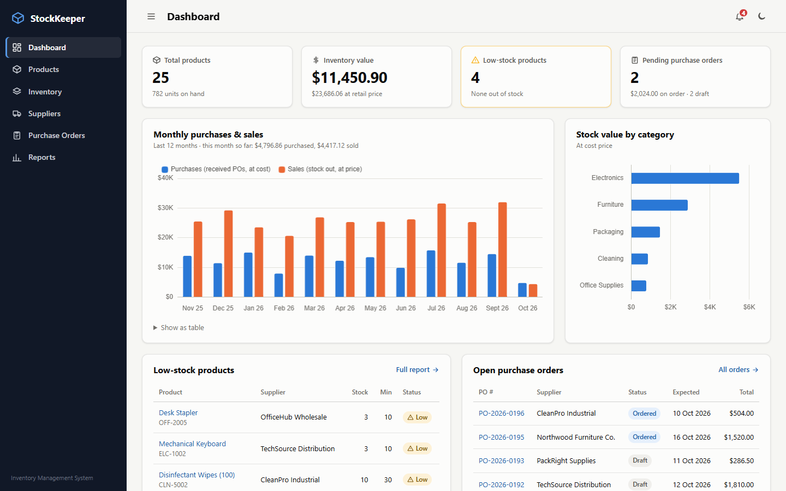
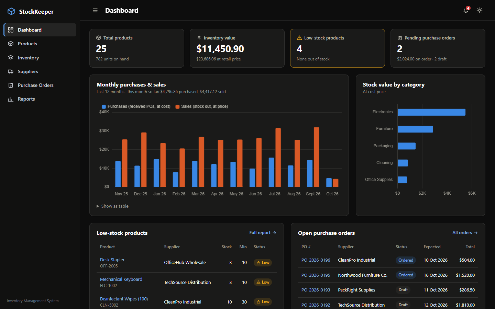
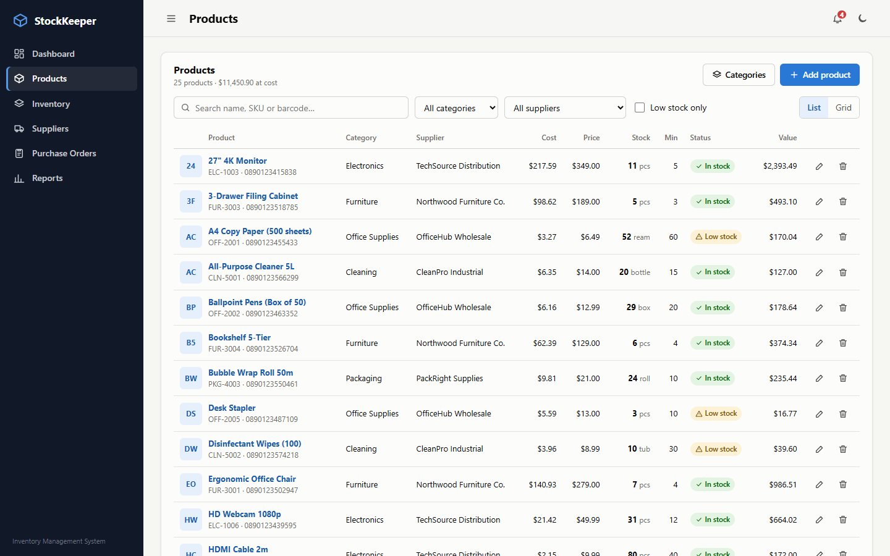
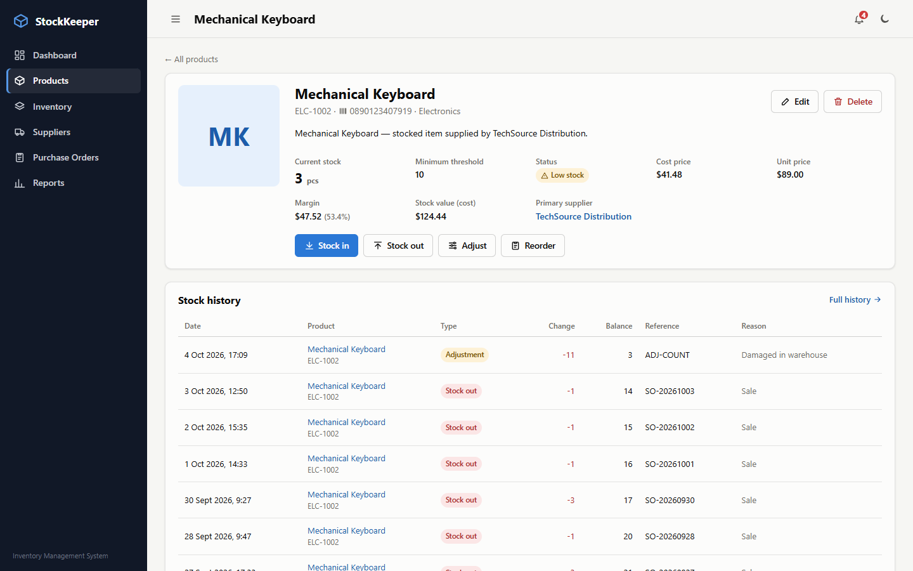
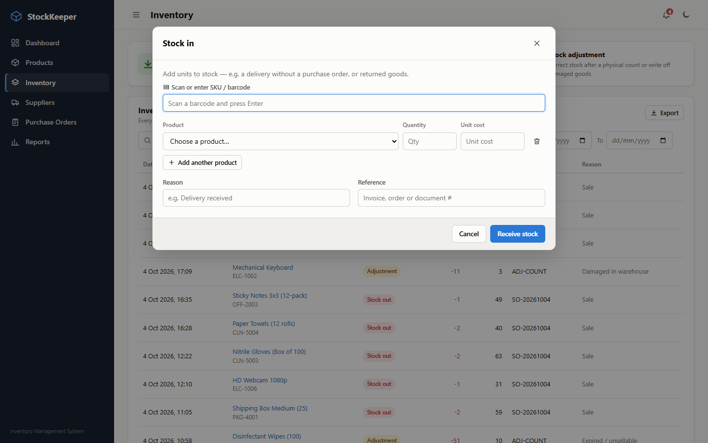
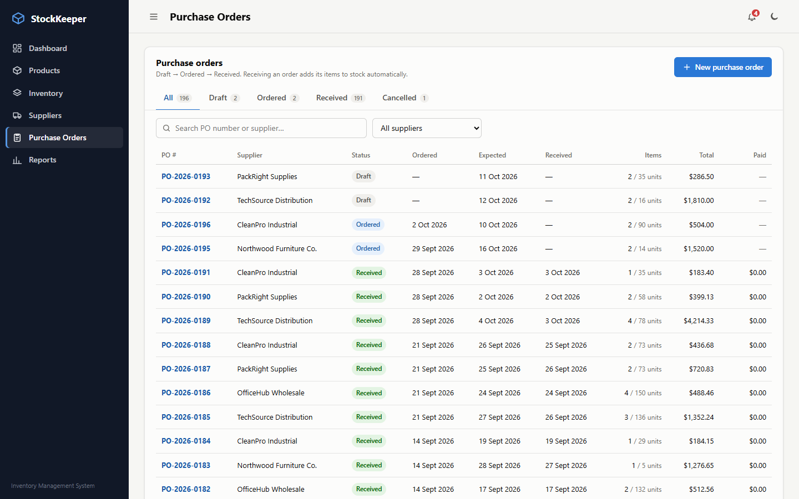
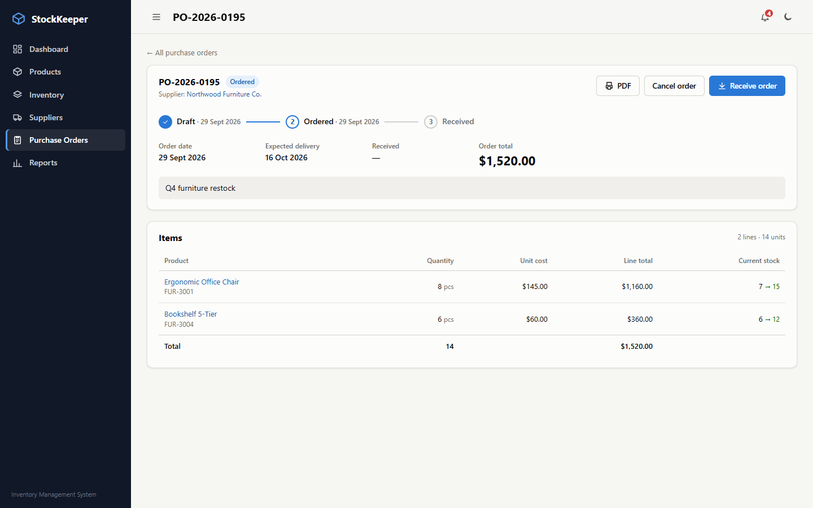
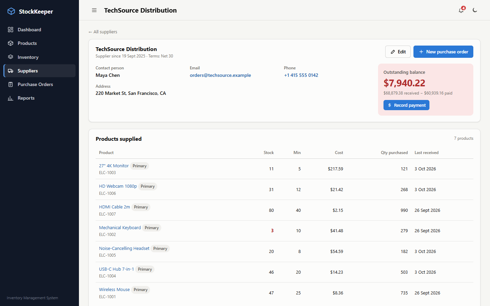
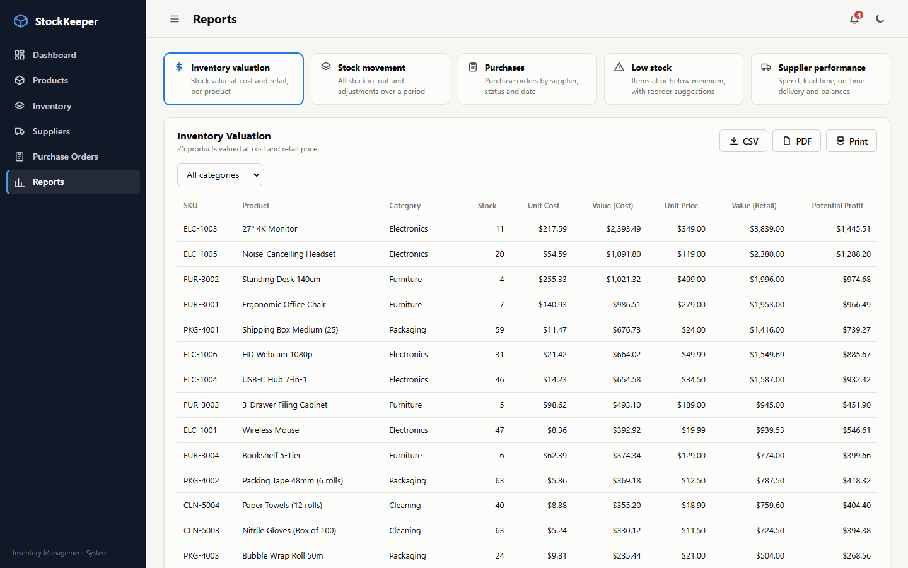
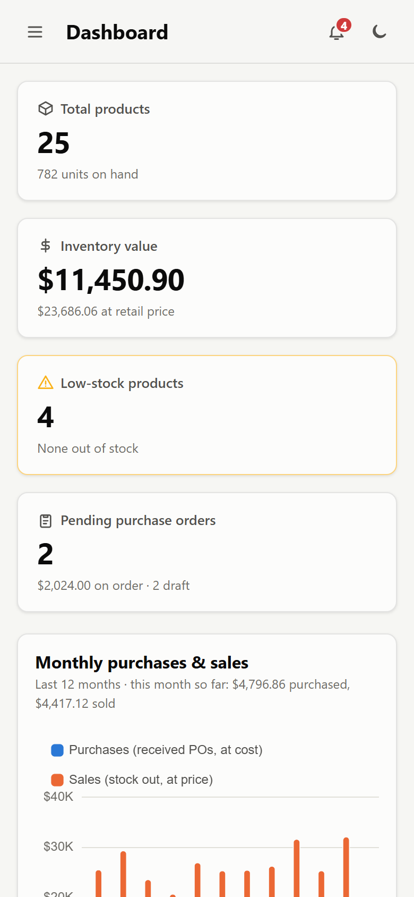

# StockKeeper: Inventory Management System

A self-hosted inventory management web app: products, stock movements, suppliers, purchase orders and reports.



**Stack:** Node.js (22.13+) · Express · SQLite (Node's built-in `node:sqlite`, so there's nothing native to compile) · vanilla JS single-page frontend · Chart.js · jsPDF. There's no build step.

## Screenshots

| | |
|---|---|
| **Dashboard (dark mode)** | **Products** |
|  |  |
| **Product detail and stock history** | **Stock in with barcode scanning** |
|  |  |
| **Purchase orders** | **Purchase order workflow** |
|  |  |
| **Supplier profile, balance and payments** | **Reports with CSV / PDF export** |
|  |  |

<p align="center"><br><em>Responsive layout on a phone</em></p>

## Getting started

```bash
npm install
npm start          # http://localhost:3000
```

On first start the database is created at `data/inventory.db` and filled with a year of simulated demo data. The demo data covers 25 products, 5 suppliers, about 190 purchase orders and about 5,700 stock movements, so the dashboard and reports have something to show.

| Command | What it does |
|---|---|
| `npm start` | Run the server (`PORT` env var to change port) |
| `npm run dev` | Run with auto-restart on server file changes |
| `npm run reset` | **Wipe all data** and reload the demo data |
| `IMS_NO_SEED=1 npm start` | Start with an empty database (on a fresh `data/` folder) |

Set `IMS_DB=/path/to/file.db` to use a different database file. Product images are stored in `data/uploads/`. Back up the whole `data/` folder.

## Features

**Dashboard**
- Shows total products, inventory value (cost and retail), low-stock count and pending purchase orders.
- Has a monthly purchases vs. sales chart (12 months), stock value by category, and lists of low-stock items, open orders and recent movements.

**Products**
- Add, edit and delete products: SKU (unique), barcode, category, primary supplier, cost and unit price (with a live margin), unit of measure, minimum stock threshold and an image upload.
- List and grid views, with search and filters for category, supplier and low stock.
- Categories can be managed from the Products page.

**Inventory**
- Stock in, stock out and adjustments, with several products per transaction. A barcode/SKU scanner field adds products as you scan.
- Adjustments take a physical count and record the difference. A reason is required.
- Stock can never go negative.
- Stock levels are only changed through movements, and every movement stores the resulting balance, so the history is a complete audit trail.
- Low-stock alerts appear in the bell in the top bar, on the dashboard and in the low-stock report.

**Suppliers**
- Supplier profile and contact details, the products they supply (primary plus anything bought from them), purchase history and payments.
- Outstanding balance = value of received purchase orders − payments. Payments can be recorded against a specific order or on account.

**Purchase orders**
- Draft → Ordered → Received, or Cancelled from Draft or Ordered. Only drafts can be edited, and received or cancelled orders are final.
- Orders can have many lines. Products from the chosen supplier are listed first, and there's a one-click "add this supplier's low-stock items" button.
- **Receiving an order adds every line to stock automatically** and updates each product's cost price to the price paid.
- Overdue orders are highlighted, and each order can be exported as a PDF document.
- Products can be reordered straight from the product page.

**Reports:** inventory valuation, stock movement, purchases, low stock (with suggested reorder quantities), and supplier performance (spend, average lead time, on-time %, fulfilment %, balance owed). Each report has filters and date presets, sortable columns, and **CSV and PDF export** plus print.

Other details: light and dark mode, a responsive layout that works on a phone, and a print stylesheet.

## Project layout

```
server/
  index.js               Express app, static files, error handling
  db.js                  Schema, helpers, applyStockChange() – the only place stock changes
  seed.js                Demo-data simulation (npm run seed / reset)
  routes/                products, categories, inventory, suppliers, purchaseOrders, dashboard, reports
public/
  index.html, css/app.css
  js/app.js              Router, alert bell, theme
  js/ui.js, api.js       Rendering helpers (auto-escaping html``), fetch wrapper
  js/charts.js, pdf.js   Chart.js and jsPDF helpers
  js/pages/*.js          One module per screen
```

## Notes and limits

- Single-user, with no login. Run it on a trusted machine or network, or put it behind a reverse proxy with authentication before exposing it.
- Currency is shown in USD. Change the `currency` formatters at the top of `public/js/ui.js` for another currency.
- "Sales" on the dashboard are stock-out movements valued at the unit price entered (by default the product's selling price).

## License

[MIT](LICENSE)
